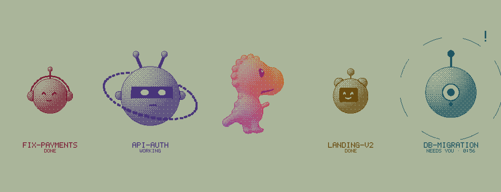

# rex-orbit

<picture>
  <source media="(prefers-color-scheme: dark)" srcset="assets/demo-dark.png">
  
</picture>

Each Claude Code session in Rex gets its own bot. You can tell at a glance which ones are working, which ones need you and which are done.

## What the bots tell you

| State | What it looks like |
| --- | --- |
| **working** | Bigger than the rest. Looks around and blinks. |
| **needs you** | Turns to face you, hops, and gets a `!` and a ring that grows the longer it waits. |
| **done** | Happy `^ ^` eyes and a smile, resting. |

Each pane keeps the same bot (face, ears, antenna, colour) for as long as it lives, and the bot is named after the conversation.

## Run it

Inside a Rex pane:

```sh
npx github:benhid/rex-orbit
```

Or from a clone:

```sh
git clone https://github.com/benhid/rex-orbit.git && cd rex-orbit
node bin/rex-orbit.mjs
npm test
```

Press `t` to switch between the light and dark theme, and `q` to quit.

### Requirements

- Node.js 20 or newer. There are no dependencies.
- Rex (macOS, beta) with the `rex` CLI on your `PATH`, and Claude Code running in one or more Rex panes. `rex-orbit` draws with Rex's [Kitty graphics](https://sw.kovidgoyal.net/kitty/graphics-protocol/) support.

### Flags

| Flag | Description |
| --- | --- |
| `--fps <n>` | Frame rate, 1 to 120. The default is 30. |
| `--theme <t>` | `auto` (the default) follows the terminal's background; `light` or `dark`. |
| `--no-dino` | Leave out the dinosaur in the middle. |
| `-h`, `--help` | Show help. |
| `-v`, `--version` | Print the version. |

## Credits

Inspired by a [post](https://x.com/Nacho_Gavilanes/status/2113281381648523396) showing superformula shapes rendered by "just turning pixels on/off". Built for [Claude Code](https://claude.com/claude-code) running inside Rex. `rex-orbit` is an independent project, not affiliated with Anthropic or the Rex team.

## License

[MIT](LICENSE) © benhid
